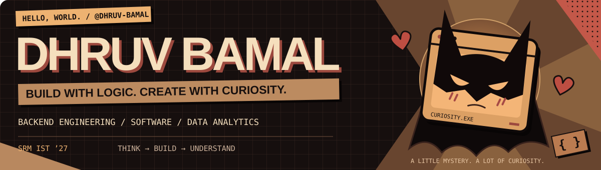
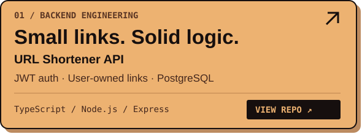
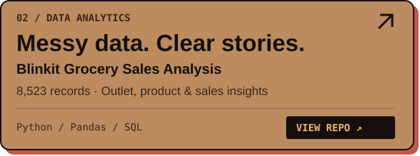
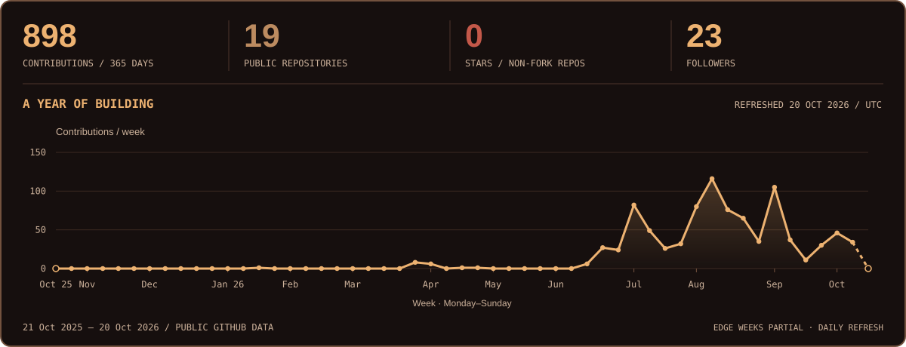

  

  <a href="mailto:bamaldhruv1105@gmail.com"><b>LET’S TALK ↗</b></a> &nbsp; / &nbsp;
  <a href="https://www.linkedin.com/in/dhruv-bamal/"><b>LINKEDIN ↗</b></a> &nbsp; / &nbsp;
  <a href="https://www.leetcode.com/_dhruvbamal"><b>LEETCODE ↗</b></a> &nbsp; / &nbsp;
  <a href="https://github.com/dhruv-bamal?tab=repositories"><b>EXPLORE MY REPOS ↗</b></a>

### 01 / The person behind the commits

I’m **Dhruv**, a final-year **CSE student at SRM IST · Class of 2027**. I build APIs, work with relational databases, and turn messy data into useful insights. I enjoy connecting careful problem-solving with practical software—and explaining what I learn along the way.

**Currently exploring:** backend engineering & generative AI. &nbsp; **A proud moment:** 1st place, Prompt Rachna 2.0 at TechStacy 2.0.

### 02 / Two things I built

### 03 / My toolbox

### 04 / The commit canvas

Curious by default. Building one commit at a time. ✳

